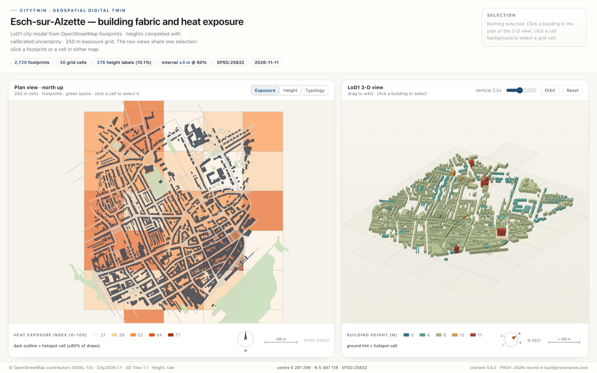
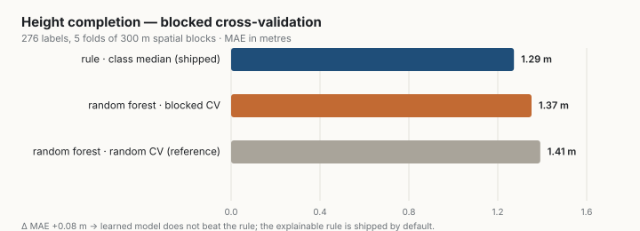

# citytwin

**An auditable geospatial digital twin toolkit — footprints in, standards out.**

`citytwin` builds a LoD1 city model from OpenStreetMap footprints, completes missing
building heights with a calibrated rule, propagates that uncertainty into an urban
heat-exposure index, and publishes the result through CityJSON, 3D Tiles and an
OGC API Features service. A small tool-using agent answers questions about the twin
by calling audited queries — never by inventing numbers.

The study area is **Esch-sur-Alzette (Luxembourg)**, 2.5 km from the LIST Belvaux
campus: 187.5 ha, 2 720 footprints, a 250 m analysis grid.

[](https://github.com/caoqyqianyi/citytwin/actions/workflows/ci.yml)
[](pyproject.toml)
[](LICENSE)
[](https://opendatacommons.org/licenses/odbl/1-0/)
[](docs/standards.md)
[](docs/standards.md)



*The self-contained viewer (`web/index.html`, no CDN, opens from `file://`): a north-up
exposure plan beside an axonometric LoD1 model. The two panels share one selection —
click a footprint or a 250 m cell in either map and the other map highlights it too.
The 3-D compass rotates with the view and reports the bearing of north.*

## Why this exists

Most "digital twin" demos stop at a pretty 3D scene. The hard part is what happens
before it: heterogeneous data, missing attributes, uncertain geometry, standards that
must be honoured, and decisions that have to be defensible afterwards. This repository
is an end-to-end answer to that, small enough to read in an afternoon.

Three ideas drive the design:

1. **Standards are the interface, not the output format.** Footprints travel as OGC API
   Features collections; geometry as CityJSON 1.1 and 3D Tiles 1.1; every artefact is
   registered in PROV-JSON with a sha256.
2. **Uncertainty is a first-class layer.** 90% of the footprints have no height tag, so
   heights are modelled, given conformal intervals, and those intervals are pushed by
   Monte Carlo into the exposure index and the hotspot decision.
3. **The agent may choose a query, never a number.** Tools are deterministic and
   read-only, each answer carries its evidence and caveats, and the planner's output is
   validated against tool schemas before anything executes.

## What it produces

| Output | Path | Size / content |
|---|---|---|
| Self-contained 2D/3D viewer | `web/index.html` | 0.86 MB, zero external requests |
| CityJSON 1.1 LoD1 model | `build/cityjson/esch_lod1.city.json` | 2 720 buildings, 0 open shells |
| 3D Tiles 1.1 tileset + GLB | `build/3dtiles/` | 52 104 triangles, 2.8 MB |
| OGC API Features | `citytwin serve` | collections `buildings`, `cells`, `green` |
| Feature store | `build/store/citytwin.sqlite` | SQLite + R\*Tree, no server needed |
| Provenance | `build/provenance.json` | PROV-JSON, re-hashable with `citytwin verify` |
| Model card & metrics | `docs/model_card.md`, `docs/metrics.json` | generated, not hand-written |
| Agent evaluation | `docs/agent_eval.md` | 12 golden questions, groundedness checks |

Key numbers from the last run (all reproducible with `citytwin build`):

| Quantity | Value |
|---|---|
| Footprints / height labels | 2 724 / 276 (10.1%) |
| Grid | 30 cells of 250 m, 187.5 ha |
| Height completion | rule MAE **1.29 m**, RMSE 2.75 m, 80% coverage 0.92, interval ±3.0 m |
| Learned benchmark (random forest) | MAE 1.37 m — **not shipped**, the rule wins |
| Exposure index | mean 50.7, hotspot threshold 71.6, 3 hotspot cells (10% of area) |
| Typology | 3 morphology clusters, silhouette 0.198, stability ARI 0.943 |
| Hotspot stability under height uncertainty | Jaccard 0.45 (mean), 1 cell above p ≥ 0.8 |
| Weight sensitivity | Spearman ρ 0.956 median |

## How the role's requirements map to this repository

| Requirement in SD-26140 | Where it is implemented |
|---|---|
| Reusable geospatial components, documented | `src/citytwin/*.py`, ~40 unit tests, `docs/architecture.md` |
| Reproducible pipelines for heterogeneous spatio-temporal data | `pipeline.py` — one call, ten recorded activities, cached OSM snapshot |
| OGC APIs, SensorThings, STAC, 3D Tiles, CityGML/CityJSON | OGC API Features service (`api/main.py`); CityJSON 1.1 and 3D Tiles 1.1 exporters; standards mapping and the STAC/SensorThings plan in `docs/standards.md` |
| APIs, microservices, interactive 2D/3D applications | FastAPI service + dependency-free 2D/3D viewer |
| Spatial analytics, simulation, GeoAI | exposure index, Monte Carlo uncertainty, KMeans typology, height benchmark with blocked CV |
| AI-assisted interfaces with provenance and oversight | `agent/` — tool registry, validated planner, MCP server, evaluation harness |
| Software engineering: tests, Git, containers, CI, docs | pytest, ruff, Dockerfile, compose with PostGIS, GitHub Actions, ADRs |

## Quickstart

```bash
git clone https://github.com/caoqyqianyi/citytwin.git
cd citytwin
python -m venv .venv && source .venv/bin/activate
pip install -e ".[dev]"

citytwin build          # full pipeline (~3 min; downloads one OSM snapshot, then cached)
citytwin verify         # re-hashes artefacts, checks CityJSON shells and the GLB
citytwin serve          # OGC API at http://127.0.0.1:8000/docs
citytwin agent "Which cells are robust hotspots at 80% probability?"
citytwin eval           # golden-question harness, writes docs/agent_eval.md
```

`make all` runs build → verify → eval → figures in one go. Everything after the first
`build` works offline.

Open `web/index.html` directly in a browser — no server, no network, no JavaScript
dependencies. `?mode=height` and `?mode=typology` switch the colouring, `?exag=0.8…4`
sets the vertical exaggeration, `?sel=<id>` and `?cell=<id>` open a given selection, and
`Esc` clears it. Both panels are drawn from one payload, so a click, a hover and a cell
selection are shared: the plan stays north-up, the 3-D compass turns with the orbit and
prints the bearing. Legends, the north arrow or compass, the scale bar and the
EPSG:25832 readout sit in a strip below each map rather than on top of it, so the canvas
is never covered. The viewer runs a small cartographic self-test at load
(`east → right`, `north → up`, in both projections) and exposes the result as
`<html data-cartography="ok">`, which `make figures` asserts before taking screenshots.

## Pipeline

```
OSM API 0.6 ──► ingest ──► features ──► height completion ──► typology ──► exposure
                  │                        │                    │            │
      GeoJSON layers          conformal intervals      KMeans + ARI    250 m grid, HEI
                  │                        │                    │            │
                  └────────────► feature store (SQLite + R*Tree) ◄───────────┘
                                                   │
              ┌────────────────────┬───────────────┴───────────────┬─────────────┐
        OGC API Features      CityJSON 1.1               3D Tiles 1.1     offline viewer
              │                    │                          │                │
              └──────────► agent tools (read-only) ◄────────────┘                │
                                   │                                            │
                          answers with evidence                    PROV-JSON provenance
```

Every arrow is an activity in `build/provenance.json`; `citytwin verify` re-computes
the hash of every registered file.

## The honest finding

The interesting result is not the 3D model — it is what the data will not support.

- **Building class beats morphology for the median building.** With 276 labels, of which
  64% are exactly two storeys, a smoothed class median (MAE 1.29 m) edges out a random
  forest with fold-safe target encoding (MAE 1.37 m) — while losing on RMSE and R².
  The repository ships the rule, keeps the model as a benchmark, and states the
  selection criterion and the trade-off in `docs/model_card.md`. Random-fold validation
  scores 1.41 m here, i.e. no spatial optimism is visible; blocked folds are still the
  only numbers quoted.
- **The hotspot decision is not identified by the height data alone.** Redrawing
  imputed heights within their 80% intervals moves the 90th-percentile hotspot set
  enough that only 1 of 30 cells stays hot in ≥80% of draws (Jaccard 0.45). That is a
  statement about label coverage, not about the city — and it is exactly the kind of
  result a decision-support tool should surface rather than hide.
- **The typology is reproducible but soft.** ARI 0.943 across subsamples, silhouette
  0.198: useful as a summary of urban fabric, not as a classifier.



## Repository layout

```
src/citytwin/
  config.py          study area, CRS, weights, paths
  ingest/osm.py      OSM API fetch, XML parsing, normalised layers
  features.py        morphology and context features, CV blocks
  model.py           rule calibration, conformal intervals, RF benchmark, model card
  analytics.py       grid, exposure index, sensitivity, Monte Carlo
  typology.py        KMeans typology, stability, exposure by type
  provenance.py      PROV-JSON writer and verifier
  store.py           SQLite + R*Tree feature store
  exporters/         CityJSON 1.1, 3D Tiles 1.1 (own GLB encoder), viewer, charts
  api/main.py        OGC API Features + analytics endpoint
  agent/             tools, planner, runner, MCP server, evaluation
  cli.py             build · fetch · serve · agent · mcp · eval · verify · export
web/                 template + generated self-contained viewer
docs/                architecture, standards, uncertainty, ADRs, model card, metrics
deploy/postgis/      reference schema for the shared-database deployment
scripts/figures.sh   re-renders the README screenshots from the viewer
configs/             exposure weights (documented, versioned)
tests/               unit and API tests on synthetic fixtures (no network)
```

## Data and licence

Source data: © OpenStreetMap contributors, **ODbL 1.0**, snapshot
`api.openstreetmap.org/api/0.6/map?bbox=5.9730,49.4920,5.9860,49.5020` (2026-11-11).
The raw XML is not committed (5 MB, regenerable with `citytwin fetch`); its sha256 is
recorded in the provenance document. Code is MIT (see `LICENSE`). Derived artefacts
inherit ODbL.

## Limitations

1. Flat-roof LoD1 only: no roof shapes, building parts, balconies or BIM.
2. Heights are static; no construction year, no vertical extension over time.
3. The exposure index is a transparent weighted sum of four normalised components —
   a screening index, not a measured temperature or a health outcome.
4. The 3D Tiles export is a single-tile prototype: no LOD tree, no 3D Tiles metadata
   or styling extension yet.
5. OGC API Features implements Core, bbox, CRS and queryables; CQL2 filtering is not
   implemented (documented in `docs/standards.md`).
6. MCP and agent layers are read-only by design; there is no write path to the city.

## Roadmap

- Replace rule-based heights with the Luxembourg LiDAR DSM / national 3D building
  model where a licence permits; keep the benchmark harness to decide whether it wins.
- Add 3D Tiles implicit tiling and a proper LOD tree once the model exceeds one tile.
- Implement CQL2 filter support and a STAC catalogue for the derived artefacts.
- Add SensorThings API ingestion for the campus sensor network, so the IoT and the
  twin share one model rather than two spreadsheets.

## Citation

```bibtex
@software{cao_citytwin_2026,
  author  = {Cao, Qianyi},
  title   = {citytwin: an auditable geospatial digital twin toolkit},
  year    = {2026},
  version = {0.5.0},
  url     = {https://github.com/caoqyqianyi/citytwin},
  note    = {Data © OpenStreetMap contributors, ODbL 1.0}
}
```

Contact: Qianyi Cao — caoqy.qianyi@gmail.com
